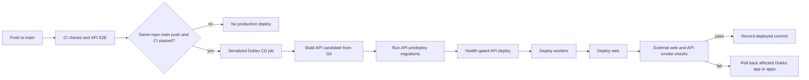

# Dokku migration implementation plan

**Date:** 2026-10-16
**Status:** Agreed plan; implementation has not started.
**Scope:** Rebuild the existing VPS around its already-installed Dokku, restore
the application's production services, and replace the current app deployment
flow with Dokku-native Git deployments and GitHub Actions CD. Terraform is
explicitly out of scope and must not be changed.

## Agreed decisions

- Rebuild the existing VPS. No replacement VPS is planned.
- Treat the deployment as a clean slate. Existing database rows, object data,
  service state, and volumes may be discarded.
- Dokku is already installed. This plan covers configuring it, not installing
  Dokku or changing Terraform.
- Deploy the repository to Dokku with the official Dokku GitHub Action and
  Dokku's Dockerfile builder. Keep the existing root build context and app
  Dockerfiles; do not publish and deploy GHCR images in production.
- Deploy only a successful CI run for a same-repository push to `main`.
- Keep Caddy, using Dokku's Caddy proxy integration.
- Restore Postgres and Redis with Dokku-maintained service plugins. Run MinIO
  and Uptime Kuma as Dokku apps using version-pinned images and Dokku-managed
  persistent storage.
- Preserve the public names `biasmarket.com`, `api.biasmarket.com`,
  `cdn.biasmarket.com`, and `status.biasmarket.com`, including their current
  route-specific behavior.
- Release in this order: migrations, API, workers, web. The migration runs as
  the API release's Dokku predeploy task after the candidate image is built and
  before replacement API containers are scheduled.
- Serialize each complete release. An active deployment, including its
  migration, is not cancelled. GitHub Actions' default concurrency behavior
  retains one pending run and replaces an older pending run when a newer run
  arrives. Do not add a custom queue or deploy dispatcher.
- Use Dokku's health-gated deploy and per-app rollback. After the release,
  blocking external smoke checks cover the public web home page and a
  database-backed API endpoint. If either fails, roll back the affected app(s)
  and fail the workflow. Check CDN and status during initial setup and after
  changes affecting those routes or services.
- Create the initial production administrator manually using the existing
  `admin:create` command. Do not run the development seed.

## Application and service inventory

| Component | Current role and constraints | Dokku target |
| --- | --- | --- |
| API | `infra/docker/api.Dockerfile`; monorepo root context; listens on 3000. Uses Postgres, Redis, MinIO, auth and internal-job secrets. Image startup does not run migrations. | Dokku `api` app using the existing Dockerfile. Its `app.json` predeploy task runs `pnpm --filter @biasmarket/db exec prisma migrate deploy` with production config. Health check plus public directory endpoint smoke. |
| Workers | `infra/docker/workers.Dockerfile`; listens on private port 3002 with `/health`; consumes Redis jobs and runs scheduled work. Needs graceful shutdown and must not scale to zero. | Dokku `workers` app using the existing Dockerfile; no public domain. Keep at least one process and configure a sufficient stop timeout. |
| Web | `infra/docker/web.Dockerfile`; Next standalone server on port 3001. `NEXT_PUBLIC_*` settings are baked in at build time; `INTERNAL_API_URL` and revalidation secret are runtime config. | Dokku `web` app using the existing Dockerfile. Supply public build args for each release and runtime values separately. Public homepage smoke expects HTTP 200. |
| Postgres | Current Compose service is PostgreSQL 18; fresh database is acceptable. | Dokku-maintained Postgres plugin and a newly provisioned service. Pin a version compatible with app dependencies and deliberate operational support; do not silently accept plugin defaults. |
| Redis | Current Compose service is Redis 7 with AOF/password. Workers require it. | Dokku-maintained Redis plugin and a newly provisioned service. Pin a version and configure authentication/persistence deliberately. |
| MinIO | Current object service; `products` and `logos` are public-read buckets; `payments` is private. The CDN exposes S3 API port 9000 only; console port 9001 is private. | Dokku app using a pinned MinIO image and Dokku storage mounted at its data directory. Add a repeatable one-off bucket/policy bootstrap. Expose only the intended S3 endpoint through CDN. |
| Uptime Kuma | Current monitor/status service; data stored in its app directory. `scripts/setup-kuma.ts` currently refers to blue/green targets. | Dokku app using a pinned image and Dokku storage at `/app/data`. Adapt and run the setup script for the Dokku app names and endpoints. |
| Caddy | Current edge routes include API security directives, web probe handling, CDN to MinIO, and a status root redirect. | Dokku Caddy integration owns proxy routing and TLS. Prove label syntax and every special route before cutover; do not expose MinIO console or workers. |

Use the current production env examples as an inventory of names, not as
production values. Expected API config includes `DATABASE_URL`,
`BETTER_AUTH_SECRET`, `BETTER_AUTH_URL`, `WEB_URL`,
`CUSTOMER_ACCOUNT_TOKEN_SECRET`, `REDIS_URL`, S3 credentials/endpoints/bucket
names, internal job and monitoring secrets, and Sentry configuration. Workers
need `REDIS_URL`, `INTERNAL_API_URL`, `INTERNAL_JOBS_SECRET`, and the configured
mail provider settings. Web needs `INTERNAL_API_URL` and
`SANITY_REVALIDATE_SECRET` at runtime, plus the documented `NEXT_PUBLIC_*`
build values. Resolve each value from the current production secret sources
during implementation; never copy development defaults into Dokku.

## Target release flow

Keep migrations, API, workers, web, smoke checks, and rollback orchestration in
one serialized deployment job. This keeps the in-flight unit explicit and
prevents cancellation between release stages. With `cancel-in-progress: false`,
GitHub Actions does not cancel the running job; its concurrency group allows
only one pending run, and a newer pending run replaces the older pending run.
This is the simpler default policy requested. Because CI completion order can
differ from commit order, retain a small stale-commit guard before deployment:
only deploy if the triggering SHA is still the current `main` head. Do not build
a custom queue. Migrations must remain compatible with the live release because
a newer pending run can supersede an intermediate release.

## Implementation phases

### Phase 0 — validate repo-specific Dokku behavior

Before rebuilding the VPS, validate the risky integration points using an
isolated disposable Dokku environment if available. Do not use the existing
production app names or domains for this rehearsal. Record the exact Dokku,
plugin, service image, and service plugin versions selected.

1. Deploy each app from the monorepo root using its existing Dockerfile path.
   Verify root build context, BuildKit cache mounts, non-root API/worker
   runtimes, and Next standalone output. Dokku's Dockerfile builder must build
   from the source checkout with the same required inputs as current CI.
2. Prove API `app.json` predeploy runs the Prisma migration command from the
   candidate API image with the connected production-like `DATABASE_URL`,
   before API replacement containers start. Prove migration failure leaves
   the prior API containers serving. Confirm all required workspace files and
   packages are present in the runtime image for that command.
3. Prove build-time `NEXT_PUBLIC_*` args reach the web build while credentials
   remain runtime Dokku config and do not enter image layers or logs.
4. Prove Dokku service networking gives API and workers stable Postgres, Redis,
   and MinIO URLs. Do not assume Compose service names or Dokku's default
   network will resolve across app/service boundaries.
5. Prove Dokku health checks use API `/api/health`, web readiness, and workers'
   private `/health` on port 3002. Workers must have no public domain.
6. Prove Caddy integration routes all four hostnames and can express current
   special behavior: API `/internal/*` returns 404, API `robots.txt` disallows
   crawling, web PHP probes return 404, status root redirects to
   `/status/status`, and CDN reaches MinIO S3 on port 9000 only. Confirm
   certificate issuance and renewal, custom label syntax, and that Dokku's
   default Nginx proxy is stopped when Caddy owns ports 80/443.
7. Prove MinIO data ownership, permissions, bucket creation and policies on an
   empty Dokku volume. Prove Uptime Kuma persists state and the setup script
   can create its status page and monitors for the new endpoints.
8. Exercise a failed build, failed migration, failed health check, worker
   shutdown, external smoke failure, and per-app rollback. Establish the exact
   rollback sequence for a partially completed API → workers → web release.

**Gate:** do not begin the destructive VPS rebuild until the release migration,
Caddy route behavior, service networking, persistent storage permissions, and
rollback behavior are demonstrated. The Caddy label integration and candidate
image migration are the largest technical fit risks.

### Phase 1 — prepare the existing VPS rebuild

1. Confirm console/SSH access, the VPS rebuild method, the current public IP,
   and the DNS records needed after the rebuild. Keep the existing four
   hostnames and point them at the rebuilt host as required. Terraform remains
   untouched.
2. Capture a read-only inventory of required production environment variable
   names and secret sources before host services are removed. Data backups are
   not required by this clean-slate plan.
3. Agree on an outage window. The current VPS is the target, so expect an
   outage while it is rebuilt and services are recreated. Current data and
   volumes may be destroyed.
4. Confirm Dokku remains installed and reachable after the planned rebuild (or
   use the provider's existing image/setup that already includes Dokku).
   Verify Docker, SSH deploy-key access, firewall ports 22/80/443, and the
   ability to manage plugins. Do not add a Dokku installer or Terraform change.

### Phase 2 — recreate services and edge routing

1. Install/pin the Dokku Caddy, Postgres, and Redis plugins. Disable the
   conflicting Dokku Nginx proxy and configure Caddy's Let's Encrypt email and
   the production domains.
2. Create fresh Postgres and Redis Dokku services using explicitly selected
   versions. Configure credentials and persistence. Connect the API and workers
   to both services using Dokku-supported service linking/networking.
3. Create MinIO and Uptime Kuma Dokku apps from pinned image tags. Attach
   Dokku-managed storage, set resource/environment config, and expose only
   their required public endpoints. Initialize MinIO buckets and policies;
   confirm the console remains private.
4. Configure Caddy domains, ports, labels, and TLS. Reproduce the exact route
   behavior in Phase 0 and run external checks against all four hostnames.
5. Adapt `scripts/setup-kuma.ts` to the Dokku topology and create monitors for
   web, API, workers where internally reachable, CDN, and status page.

### Phase 3 — create and configure application apps

1. Create Dokku apps `api`, `workers`, and `web`. Configure the Dockerfile
   builder and repo-relative Dockerfile paths:
   `infra/docker/api.Dockerfile`, `infra/docker/workers.Dockerfile`, and
   `infra/docker/web.Dockerfile`. Keep the repository root as build context.
2. Set app ports to match the image listeners: API 3000, workers 3002, and web
   3001. Route only API and web publicly; configure workers for private health
   checks only. Set worker count to at least one and configure graceful stop
   timeout.
3. Set Dokku runtime config for each app from the production secret inventory.
   Set web `NEXT_PUBLIC_*` build args separately from runtime config and verify
   that no credentials are build args.
4. Configure the API predeploy task for `pnpm --filter @biasmarket/db exec
   prisma migrate deploy`. Keep migration locking and destructive-migration
   CI checks. Continue expand/contract migrations; Dokku can roll back app
   images, but it cannot safely reverse arbitrary database changes.
5. Deploy apps in order: API (including predeploy migrations), workers, web.
   Confirm health and compatibility at each boundary. Create the first admin
   manually through `admin:create`; do not run `seed:base`, which provisions
   development users and sample sellers.

### Phase 4 — replace production CD

1. Preserve `.github/workflows/ci.yml` as the quality gate. CD must require a
   successful CI `workflow_run`, same repository, `main` push event, and exact
   triggering SHA. Keep fork protection and permissions minimal.
2. Replace the GHCR and VPS blue/green orchestration in `cd.yml` with the
   official Dokku GitHub Action deploying the triggering source revision to
   Dokku. Use root context and the Dockerfile builder configured per app.
3. Put migration → API → workers → web → public smokes in the same sequential
   deploy job and concurrency group. Set `cancel-in-progress: false`. Keep the
   stale-main SHA guard so an old CI completion does not enqueue an outdated
   revision. Do not add workflow cancellation logic that interrupts a running
   migration or release.
4. After app deploys, perform blocking checks from the GitHub runner:
   `https://biasmarket.com/` must return 200 and
   `https://api.biasmarket.com/api/stores/directory` must return 200. These
   validate the public edge and the API/database path. Check CDN and status at
   initial cutover and after relevant service, domain, or proxy changes.
5. On failed smoke checks, run Dokku rollback for the affected app(s), in the
   reverse release order when more than one app has changed, then fail the
   workflow. Verify rollback behavior and provide the deployed SHA and rollback
   result in the job summary. Do not claim a database rollback for migrations.
6. Preserve the CI destructive migration gate and compatibility rules. The
   existing migration backup behavior may be removed only if it is solely an
   old deploy-path concern and no longer required by repository policy.

### Phase 5 — cut over and observe

1. Rebuild the existing VPS during the agreed outage window and configure the
   clean Dokku host and all services. Recreate DNS/Caddy/TLS as needed for the
   same four hostnames.
2. Deploy a successful `main` revision through the new GitHub Actions workflow.
   Initialize the buckets, Uptime Kuma configuration, and manual production
   admin. Run the full external route/smoke checklist before announcing
   service restored.
3. Observe web/API errors, worker queue progress, Postgres connections, MinIO
   operations, resource pressure, and health checks for an agreed initial
   period. Confirm restart behavior for every Dokku app and plugin service.
4. Rehearse a per-app rollback and a failed smoke rollback. Since the service
   data was intentionally reset, rollback restores application code only; it
   does not restore old database/object/service state.

### Phase 6 — retire the old deployment implementation and update docs

After the Dokku deployment is stable and rollback is rehearsed, remove obsolete
blue/green deploy orchestration, GHCR production image publishing if unused,
color-specific runtime env files, old app Compose profiles, VPS deploy
dispatcher/watchdog/scheduler units, deploy-only rsync credentials, and
secrets used only by the old flow. Keep CI quality and destructive-migration
checks. Update `docs/core/deploy.md`, `docs/core/blue-green-migrations.md`,
`docs/core/infra.md`, `CLAUDE.md`, and relevant operator/admin runbooks.

Correct the existing documentation mismatch during that update: `docs/core/infra.md`
describes base seed execution at API boot, while the production API Dockerfile
starts the compiled server directly. Document the actual Dokku production
startup and manual admin creation. Keep Terraform files out of the change.

## Risks and controls

| Risk | Control |
| --- | --- |
| Caddy plugin may not express every custom route or may label only expected Dokku web processes | Phase 0 route spike; block rebuild until all routes, TLS, and private MinIO console behavior work. |
| Dokku predeploy may not have all files or env needed for Prisma in the candidate image | Prove candidate-image migration before cutover; fail release if it fails; keep old API serving. |
| GitHub pending-run replacement can skip an intermediate release | Preserve current-head SHA guard; use backward-compatible expand/contract migrations and code that tolerates adjacent versions. |
| Releases span separately deployed apps | Deploy API → workers → web serially, maintain compatibility, smoke and rollback each affected app in reverse order. |
| Service plugins may default to unexpected major versions | Select and record explicit PostgreSQL and Redis versions; validate app compatibility before first production deploy. |
| MinIO storage or bucket policy is wrong on a clean install | Test an empty persistent volume, permissions, bucket bootstrap, public-read/private policies, and private console. |
| Full VPS rebuild causes an outage and destroys all service state | Schedule explicitly, capture configuration/secret names, and verify access and DNS readiness before starting. Data loss is accepted. |
| API/web checks can pass without proving all routes | Keep API/web checks on every release; run CDN/status checks on initial cutover and relevant configuration/service changes. |

## Current behavior and files to revisit during implementation

- `.github/workflows/cd.yml`: current `workflow_run` gate, SHA-tagged GHCR
  build/deploy path, non-cancelling deploy serialization, and public smoke
  implementation.
- `infra/docker/api.Dockerfile`, `web.Dockerfile`, `workers.Dockerfile`: keep
  their root build context and runtime contracts; configure Dokku Dockerfile
  paths and build args.
- `infra/vps/Caddyfile` and `infra/vps/lib/smoke.sh`: route/security behavior
  and existing smoke expectations to reproduce.
- `infra/vps/docker-compose.yml`: current Postgres, Redis, MinIO, and Kuma
  service configuration to translate to Dokku plugins/apps.
- `scripts/setup-kuma.ts`: update blue/green monitor targets for Dokku.
- `docs/core/admin-access.md`: manual production admin creation procedure.
- `docs/core/deploy.md`, `docs/core/blue-green-migrations.md`,
  `docs/core/infra.md`: replace old deployment and startup guidance after
  cutover.

## References

- [Dokku GitHub Actions](https://dokku.com/docs/deployment/continuous-integration/github-actions/)
- [Dokku Dockerfile builder](https://dokku.com/docs/deployment/builders/dockerfiles/)
- [Dokku deployment tasks](https://dokku.com/docs/advanced-usage/deployment-tasks/)
- [Dokku Caddy proxy](https://dokku.com/docs/networking/proxies/caddy/)
- [Dokku plugins](https://dokku.com/docs/community/plugins/)
- [Dokku persistent storage](https://dokku.com/docs/advanced-usage/persistent-storage/)
- [GitHub Actions concurrency](https://docs.github.com/en/actions/how-tos/write-workflows/choose-when-workflows-run/control-workflow-concurrency)
- Repo baseline: [`docs/core/deploy.md`](../core/deploy.md),
  [`docs/core/blue-green-migrations.md`](../core/blue-green-migrations.md),
  [`infra/vps/docker-compose.yml`](../../infra/vps/docker-compose.yml),
  [`.github/workflows/cd.yml`](../../.github/workflows/cd.yml).
