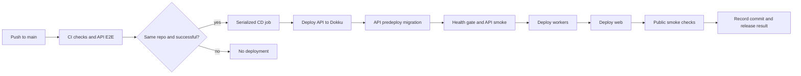

# CD migration plan: blue/green VPS pipeline to Dokku

**Date:** 2026-10-16
**Scope:** Replace the bespoke production deploy state machine with Dokku for
the `api`, `web`, and `workers` applications. CI quality gates and the existing
stateful services are in scope only where the deployment change depends on
them. This is an audit and proposed plan; no production changes have been made.

## Recommendation

Adopt Dokku for app lifecycle, deployment, health-gated routing, release
history, and rollback. Prefer Dokku's **Git deployment with the existing
Dockerfiles** for the first migration. That gives each deploy a source checkout
and lets the API use Dokku's predeploy/release task before new containers are
scheduled. Keep GitHub Actions as the CI gate and deploy client.

Treat the target as a clean install: existing production data and volumes may be
discarded, and the new deployment starts with empty service data. Keep the
stateful-service migration out of the CD work: provision fresh Postgres, Redis,
MinIO, and Uptime Kuma services for the target. They may remain Compose-managed
or move to Dokku-supported service plugins where an appropriate plugin exists;
that choice should be recorded as part of host setup, not mixed into app release
automation. Establish a backup policy for data created after launch separately.

Dokku can also deploy the existing GHCR images. That preserves the current
“build once in CI, run that exact image” property, but image-only deployment
does not naturally include this repository's `app.json`/Procfile release task
and source files. The API migration workflow would then need a separate,
custom candidate-image execution path. Prefer the Dockerfile builder unless a
short Dokku spike proves that Git deployment cannot preserve the build contract.
Dokku supports custom Dockerfile paths for monorepos; this repo's Dockerfiles
use the repository root as context and must be tested against that behavior.

An in-place migration of existing data is out of scope. A fresh host or an
intentional rebuild of the current VPS is acceptable even if it destroys the
existing database, MinIO objects, and service volumes. Terraform's cloud-init
`user_data` is documented as a reinstall trigger, so review the plan and make
that replacement/reinstallation an explicit part of the cutover schedule.

## Current deployment inventory

| Concern | Current implementation | Dokku target |
| --- | --- | --- |
| CI authorization | `.github/workflows/ci.yml`, then `cd.yml` listens to successful CI `workflow_run`; same-repository `main` push gate | Preserve the CI success gate, fork protection, and a single non-cancelling production deploy concurrency group |
| Image build | GitHub Actions builds `api`, `web`, `workers` for the repo-root context using `infra/docker/{api,web,workers}.Dockerfile`, tags each image with the commit SHA, and pushes to GHCR | First choice: Dokku Git deploys the same repo and selects each Dockerfile path. Keep the Dockerfiles and their root context. CI remains the test gate; Dokku does the production build. Alternative: keep GHCR and deploy images with `git:from-image` |
| Deploy orchestration | ~1,800 lines of deploy-specific shell/YAML plus ~300 lines of blue/green Compose; `deploy.sh`, nine `lib/*.sh`, two VPS bin scripts, two workflows, SSH setup action, watchdog units | Dokku owns app build/release/deploy/rollback and proxy coordination. Remove only after equivalent behavior is proven |
| App topology | `api`, `web`, `workers`, each blue/green; three independent images | Three Dokku apps/process groups, with serial deploy ordering and explicit compatibility across versions |
| Health/cutover | Docker healthchecks, direct smoke tests, Caddy canary, public-domain smoke tests, previous color held for a rollback window | Dokku zero-downtime deploy checks and health-gated proxy routing; retain post-deploy public smoke checks in CI until the Dokku checks prove equivalent coverage. Dokku rollback is per app, so a coordinated release rollback procedure is still needed |
| Schema migration | Candidate image migration phase before starting the candidate; destructive keyword gate, pre-migration `pg_dump`, short lock timeout, advisory-lock handling, expand/contract discipline | API predeploy/release task runs the candidate's migration command before new API containers start. Preserve the CI destructive-migration gate and lock timeout; verify failure leaves the prior release serving. Existing-data backup is not a cutover requirement for this clean install |
| Edge routing/TLS | Caddy serves `biasmarket.com`, `api.biasmarket.com`, `cdn.biasmarket.com`, and `status.biasmarket.com`; custom blocks include API path rules, robots response, PHP probe rejection, root redirect, and reverse proxying MinIO/Kuma | Evaluate Dokku's Caddy proxy integration and label directives against every current route. It supports Caddy Docker Proxy labels and custom labels, but only `web` process containers receive Dokku's Caddy labels by default. Do not cut over until CDN/status routes, custom directives, TLS renewal, and reload behavior are demonstrated |
| Persistent services | Existing Compose-managed Postgres, Redis, MinIO, Uptime Kuma volumes; one VPS | Keep and protect current data volumes. Dokku warns that out-of-band Docker management can conflict with its cleanup/lifecycle assumptions; document ownership boundaries and verify its cleanup does not touch existing services or volumes |
| Provisioning/access | Terraform Contabo VM/cloud-init; restricted rsync and forced-command SSH keys; GitHub environment secrets | Replace deploy-only keys/dispatcher with a restricted Dokku SSH deploy key/user and pinned host key. Review firewall, Dokku admin key access, plugin pinning, and Terraform `user_data` reinstall behavior |

### Existing guarantees to preserve

1. Only a successful CI run for a same-repository push to `main` can deploy.
2. The deployed source/image is tied to the exact triggering commit; delayed CI
   completions cannot overwrite a newer release with an older one.
3. Production deploys serialize and are not cancelled mid-cutover.
4. Schema changes are backward-compatible with the currently serving release;
   migration failures leave the old release serving.
5. Web's `NEXT_PUBLIC_*` values are build-time inputs, while API, worker, and
   other credentials are runtime configuration. Secrets must not enter image
   layers or logs.
6. Workers shut down gracefully, and handlers that may be retried remain
   idempotent.
7. Public smoke checks cover the public hostnames after deployment.

## Proposed deployment shape

The API-first order keeps the migration and API release together. Workers and
web then move forward serially. The exact ordering of web versus workers should
be confirmed against current API contract changes; deploy only code versions
that tolerate the adjacent old/new version during the rollout. Do not parallelize
the three Dokku app deploys.

## Migration phases

### Phase 0 — prove the Dokku fit

Use a disposable host or isolated staging VPS, not the live VPS. Pin the Dokku
version and plugin revisions used in the spike. Prove these repo-specific items:

- Each app can deploy from the monorepo root with its selected Dockerfile:
  `infra/docker/api.Dockerfile`, `web.Dockerfile`, or `workers.Dockerfile`.
- Dockerfile build context remains the repository root, all current BuildKit
  cache mounts work, and `api`/`workers` remain non-root runtime images.
- Web build args match current GitHub Variables and are baked into the same
  commit's image. Runtime secrets stay Dokku config values, not build args.
- Dokku's predeploy task runs `pnpm --filter @biasmarket/db exec prisma migrate
  deploy` using the new API image and the production-like `DATABASE_URL`, before
  replacement API containers start. A failed migration leaves the old API live.
- Dokku health checks cover API `/api/health`, web readiness, and the workers'
  existing private HTTP `/health` endpoint on port `3002`. Verify that worker
  checks remain internal and do not publish a public route.
- GitHub Actions can deploy exact commits, serialize releases, reject stale
  commits, and recover from an interrupted runner without a custom server-side
  dispatcher.
- The Dokku Caddy integration can express all four current host routes and
  special Caddy behavior, including MinIO/Kuma routes and API deny/robots
  handling. Confirm who owns and renews certificates.
- Existing Compose services and volumes survive Dokku cleanup/redeploy, and
  Dokku app containers can reach the shared database, Redis, and MinIO on an
  explicit shared network.
- A failed deploy can roll back each app to the intended release, and the
  operator can coordinate rollback across all three apps.

**Gate:** do not proceed if release-time migrations cannot be run once against
the candidate build before API scheduling, if proxy behavior cannot be
reproduced, or if shared-service ownership and app connectivity are unclear.

### Phase 1 — provision the clean host

1. Decide between a replacement VPS and intentionally rebuilding the current
   VPS. A replacement host permits a hostname-based smoke period; rebuilding is
   simpler but causes a production outage while Dokku and services are set up.
   Existing service volumes and application data can be discarded.
2. If using Terraform, review the plan for `image_id`, `user_data`, SSH keys,
   and firewall changes. The documented cloud-init behavior may reinstall the
   instance; schedule this as an intentional destructive rebuild.
3. Install a pinned Dokku release and the required Caddy integration on the
   target. Keep SSH, 80, and 443 access constrained as today. Use a dedicated
   deployment key and a pinned `known_hosts` entry.
4. Provision fresh service instances and empty persistent volumes for
   PostgreSQL, Redis, MinIO, and Uptime Kuma. Choose Compose or Dokku service
   plugins per service and document ownership. Establish app runtime
   configuration from the current `env/*.env` examples
   and GitHub production variables/secrets. Compare the effective environment
   variable names per app before starting traffic.

### Phase 2 — configure apps and shared services

1. Create Dokku apps for `api`, `web`, and `workers`; set each app's Dockerfile
   path and explicitly choose the Dockerfile builder.
2. Attach the apps to a named network reachable by existing Postgres, Redis,
   and MinIO services. Do not assume Dokku's default app network can resolve
   current Compose service names; prove it and set explicit hostnames/URLs.
3. Configure app ports to match image listeners: API `3000`, web `3001`, and
   workers `3002` (workers do not need public routing). Set web's public build
   args and all runtime variables separately.
4. Configure domains only for the web and API apps. Recreate CDN and status
   routes for MinIO and Uptime Kuma. Apply custom Caddy directives for the API
   `/internal/*` block, `/robots.txt`, web PHP probe response, and status root
   redirect. Ensure MinIO's admin port remains private.
5. Configure health checks and graceful stop timeouts. Verify workers finish
   in-flight jobs or are safely recovered by BullMQ on termination.

### Phase 3 — move CI/CD

1. Preserve `ci.yml` and its required CI-success gate. Keep the same-repository,
   `main`-branch and commit-SHA checks; retain full history if ancestry is used
   to reject stale workflow completions.
2. Replace the GHCR build/deploy workflow path with serial `dokku` Git deploys
   using the official Dokku GitHub Action or a narrowly-scoped SSH deploy step.
   First deploy the API, then the agreed order for workers and web. Set a
   production concurrency group with `cancel-in-progress: false`.
3. Keep a post-deploy public smoke step for `https://api.biasmarket.com/api/health`
   and `https://biasmarket.com`; add checks for CDN and status behavior.
4. Retain the destructive migration CI gate and backup/lock timeout behavior.
   Remove only migration/deploy mechanisms whose equivalent Dokku behavior has
   been exercised. If the predeploy task cannot invoke candidate-image
   migrations, pause and reconsider GHCR image deployment plus a supported
   candidate migration runner rather than silently moving migration to API boot.
5. Exercise a stale commit, failed build, failed migration, failed health check,
   worker shutdown, and coordinated rollback before production cutover.

### Phase 4 — production cutover

1. Prefer a new VPS with a temporary hostname. Validate end-to-end traffic
   through the intended Dokku proxy and certificate flow before moving DNS.
2. Lower DNS TTL ahead of cutover where applicable. Confirm Cloudflare proxy
   settings and DNS records for all four hostnames.
3. Schedule a supervised cutover. Do not run the existing Caddy and Dokku's
   Caddy integration on the same host/ports simultaneously. Switch DNS or the
   edge route only after the Dokku host passes the full smoke checklist.
4. Watch API errors, queue depth/worker progress, Postgres connections, MinIO
   access, memory/swap, and health checks through a defined observation window.
5. Keep the old VPS available during the rollback window if using a replacement
   host. For an in-place rebuild, rollback means redeploying the previous
   application release on Dokku; the deleted data is not restored. Database
   migrations still follow expand/contract for safe future releases.

### Phase 5 — retire bespoke CD

After the observation window and an application rollback rehearsal, remove the
obsolete blue/green dispatcher, deploy state machine and libraries, color-based
runtime env files, old app Compose profiles, cleanup fallback workflow,
migration watchdog/scheduler units, deploy-only rsync key, and associated
Terraform/GitHub secrets. Update `docs/core/deploy.md`,
`docs/core/blue-green-migrations.md`, `docs/core/infra.md`, `CLAUDE.md`, and
operator/admin runbooks. Keep the CI destructive migration check and migration
discipline unless separately replaced by an equivalent reviewable control.

## Risks and decisions still needed

| Risk/decision | Why it matters | Resolution before cutover |
| --- | --- | --- |
| Current VPS has a single Docker daemon shared by Compose services | Dokku and Compose both manage Docker; Dokku warns against out-of-band Docker operations | Prefer a fresh host; otherwise prove cleanup/network behavior and ownership boundaries |
| Migration task and image deploy method | Candidate migration must run once before API scheduling; image-only deploy has no source manifest by default | Prove Dockerfile-builder predeploy against candidate image, or design and test a candidate migration runner |
| Per-app deploys replace atomic three-service cutover | During rollout, app versions are mixed; Dokku rollback is per app | Specify compatible rollout order and a coordinated rollback command/runbook |
| Caddy behavior is richer than simple host routing | Current route has custom directives and shared non-Dokku containers | Reproduce and test all paths, security rules, TLS, and non-app routes with the selected proxy integration |
| Build-time web configuration | `NEXT_PUBLIC_*` values are compiled into the frontend | Set and audit build args for each app deploy; do not confuse them with runtime config |
| Host provisioning side effects | Terraform cloud-init is documented as one-time and user-data changes may reinstall the instance | Review the plan and schedule the destructive rebuild; existing data loss is accepted |

## Expected reduction

The current audit counted roughly 1,800 lines of deploy-specific bash/YAML and
about 300 lines of blue/green Compose. Dokku should remove most custom
locking/state/cutover/rollback/cleanup code after the migration is proven. The
result still includes GitHub workflow configuration, app setup/configuration,
health checks, migration controls, Caddy directives, and operational docs; the
goal is to delegate standard deploy mechanics to Dokku, not to erase application
release policy.

## References

- [Dokku: Deploying an Application](https://dokku.com/docs/deployment/application-deployment/)
- [Dokku: Dockerfile Deployment](https://dokku.com/docs/deployment/builders/dockerfiles/)
- [Dokku: Docker Image Deployment](https://dokku.com/docs/deployment/methods/image/)
- [Dokku: GitHub Actions](https://dokku.com/docs/deployment/continuous-integration/github-actions/)
- [Dokku: Deployment Tasks](https://dokku.com/docs/advanced-usage/deployment-tasks/)
- [Dokku: Caddy Proxy](https://dokku.com/docs/networking/proxies/caddy/)
- Repo baseline: [`docs/core/deploy.md`](../core/deploy.md),
  [`docs/core/blue-green-migrations.md`](../core/blue-green-migrations.md),
  [`infra/vps/docker-compose.yml`](../../infra/vps/docker-compose.yml),
  [`infra/terraform/cloud-init.yaml.tftpl`](../../infra/terraform/cloud-init.yaml.tftpl),
  [`.github/workflows/cd.yml`](../../.github/workflows/cd.yml).
